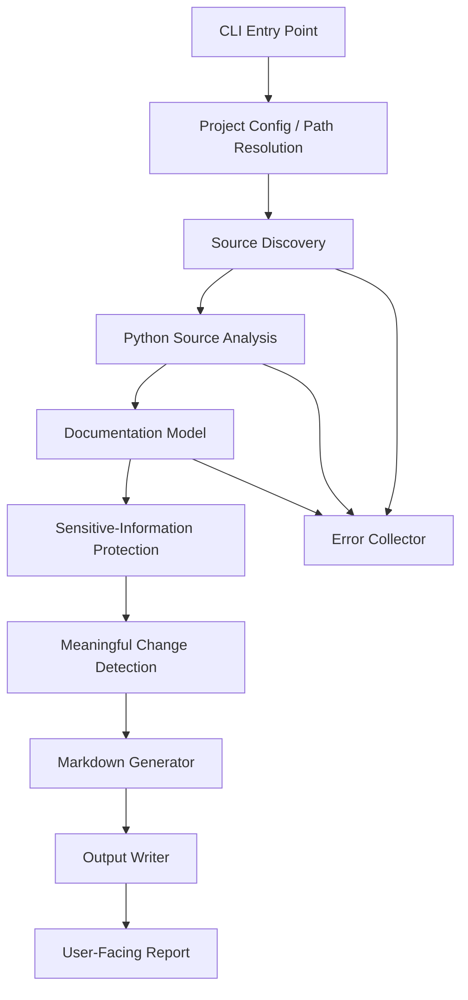
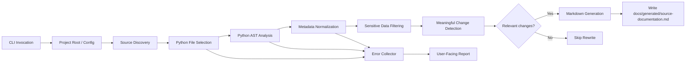

# Architecture

Status: draft pending Architecture approval

> This document is an unapproved draft. It is derived from the approved requirements in [requirements.md](requirements.md) and is intended to stop at the Architecture human-approval checkpoint before any later SDLC phase begins.

## 1. Architecture overview

This project is a CLI-driven documentation synchronization tool for a Python repository. Its purpose is to analyze repository-local Python source files, extract relevant project facts, and generate a Markdown document in a dedicated generated-output location without modifying manually authored documentation.

The architecture intentionally stays small and testable. It avoids runtime execution, database storage, GUI interfaces, API services, and CI automation. The system is designed to be resilient: one broken or unsupported file should not prevent the tool from documenting the valid files that can still be processed.

The architecture is derived directly from the approved requirements in [requirements.md](requirements.md) and does not create new requirements beyond the MVP scope.

### Component architecture

## 2. Architectural constraints

- MVP only
- Python source files only
- Markdown output only
- CLI only
- No database or persistent state beyond generated output
- No GUI or web service
- No CI/Git-hook automation
- Must not overwrite manually written documentation
- Generated output path is fixed at docs/generated/source-documentation.md
- Default exclusions must include .git/, .github/, .venv/, venv/, __pycache__/, tests/, build/, dist/, and generated output directories
- Sensitive values must not be intentionally included in generated output
- Missing or uncertain data must be reported explicitly rather than invented

## 3. Key components and responsibilities

### 3.1 CLI entry point
Responsible for parsing the user invocation, validating the project path, and starting the sync workflow. It provides the manual trigger required by the MVP and communicates meaningful errors back to the user.

### 3.2 Project configuration and path resolution
Responsible for resolving the configured project root, identifying the target source directories, and keeping output paths separated from manual content. It is responsible for preventing writes outside the designated generated output area.

### 3.3 Source discovery layer
Responsible for walking candidate directories, applying default exclusions, and selecting Python files for analysis. It enforces the requirement to ignore irrelevant directories and files by default.

### 3.4 Python source analysis layer
Responsible for reading Python files and extracting project-relevant information using Python's AST and lightweight metadata extraction. This layer identifies modules, classes, functions, imports, docstrings, and other high-signal items without executing user code.

### 3.5 Sensitive-information protection layer
Responsible for scanning discovered content and generated summaries for patterns associated with secrets or credentials. It filters or redacts those values before they are added to the generated Markdown. The protection acts both on input and generated output.

### 3.6 Meaningful-change detection
Responsible for comparing the current extracted project model against the last generated output or prior normalized snapshot. It decides whether a rewrite is necessary and suppresses no-op updates when documentation-related content has not meaningfully changed.

### 3.7 Documentation model and generator
Responsible for converting normalized metadata into a predictable Markdown structure. It keeps output readable and reviewable, while explicitly labeling missing or uncertain information instead of fabricating values.

### 3.8 Output writer
Responsible for writing only to docs/generated/source-documentation.md and for creating the generated directory when needed. It avoids overwriting manually authored documentation stored outside the generated output location.

### 3.9 Error collector and reporter
Responsible for aggregating per-file issues such as parse failures, unsupported paths, missing files, or sensitive-value exclusions. It reports important problems clearly while still allowing valid files to be processed.

## 4. Component interactions

The components form a linear workflow with explicit validation boundaries:

1. CLI receives a manual trigger and a configured project root.
2. Path and exclusion rules are applied to determine the candidate source set.
3. Python files are discovered and read one by one.
4. Each file is parsed with standard-library tools without executing code.
5. Relevant metadata is normalized into a project model.
6. Sensitive content is filtered or redacted.
7. The current model is compared against the prior generated state.
8. If meaningful changes are found, Markdown is generated and written to the generated output file.
9. If no meaningful change is found, the tool exits cleanly without unnecessary rewriting.
10. Errors are collected and surfaced to the user without crashing the whole run.

## 5. Technology choices and rationale

### Python standard library
Use Python's standard library for the MVP wherever practical:

- argparse for the CLI
- pathlib and os for path and directory management
- ast for Python source analysis
- re for sensitive-data detection and content sanitization
- json or a simple normalized data model for intermediate metadata
- hashlib or normalized text comparisons for change detection
- datetime or timestamps only if needed for reporting

Rationale:
- Fits the MVP requirement for a Python-only, lightweight, reviewable solution.
- Minimizes dependency burden and cross-platform risk.
- Keeps the project portable across Windows, Linux, and macOS.
- Limits the implementation to a small and testable surface area.

### Markdown as output format
Markdown is required by the approved requirements and is the simplest structured output for repository documentation.

### No database or service layer
The project does not require persistent state; generated documentation is the single source of truth for output. This avoids an unnecessary runtime service and keeps the design aligned with the CLI-only scope.

## 6. End-to-end data flow

## 7. CLI interaction

The CLI is intentionally simple and manual for the initial release. It acts as the entry point for a user who wants to synchronize generated repository documentation from the current source tree.

The architecture assumes:
- a single root project location is provided or implied by current working directory
- the command is run manually by a developer
- the tool reports results and warnings clearly
- invalid paths and unsupported files do not terminate the entire workflow

The CLI is not responsible for Git automation, CI triggers, or editor integration. Those are explicitly out of scope for the MVP.

## 8. Source discovery

The discovery layer is responsible for identifying candidate Python files while honoring the default exclusions and avoiding irrelevant content.

Default exclusion behavior:
- .git/
- .github/
- .venv/
- venv/
- __pycache__/
- tests/
- build/
- dist/
- generated documentation/output directories

Discovery rules:
- walk only configured source directories
- keep the search scope narrow and predictable
- ignore directories and files that are known to be irrelevant
- skip unsupported file types without failing the entire scan
- keep manual documentation outside the output path untouched

This supports REQ-F-01 and REQ-F-11 and preserves a clean separation between generated and authored content.

## 9. Python source analysis

The source analysis layer reads Python sources and extracts only the information relevant to project documentation.

Typical metadata to extract:
- module names
- classes and inheritance relationships where available
- public functions and methods
- docstrings and inline summaries
- imports and primary dependencies
- obvious file-level purpose or project structures

Analysis strategy:
- use Python's AST parser rather than executing code
- capture information that is valuable for documentation without overfitting to implementation detail
- treat missing or unclear information as a gap to report, not as a fact to invent
- keep analysis resilient so that one invalid file does not stop valid files from being processed

This directly supports REQ-F-02, REQ-F-07, and REQ-F-08.

## 10. Documentation model and generation

The generated Markdown should follow a deterministic structure that is easy to review and predictable across runs.

Suggested structure:
- title and generation summary
- project overview section
- source scope and exclusions
- modules discovered
- classes and functions summary
- notable interfaces or dependencies
- explicitly marked unknowns or gaps
- warnings and skipped items, if any

The generator should not invent missing facts. When data is absent or uncertain, it should record a clear gap such as “Not available from the current source set” instead of fabricating a value.

This supports REQ-F-03, REQ-F-04, and REQ-NF-05.

## 11. Sensitive-information protection

The tool must avoid intentionally including sensitive values in generated docs. This is a safety requirement, not just a presentation choice.

Protection strategy:
- detect obvious secret patterns such as tokens, passwords, API keys, bearer strings, and connection strings
- remove or redact values before they are included in the model or generated Markdown
- suppress sensitive excerpts from reports unless they are intentionally sanitized
- maintain a fail-safe default: if a value cannot be confidently classified as safe, prefer omission over exposure

The design should be conservative and explicit. The architecture chooses omission and redaction over accidental disclosure.

This supports REQ-F-09 and REQ-NF-02.

## 12. Meaningful-change detection

The tool must avoid needless rewrites of generated documentation when no meaningful documentation-related change has occurred.

Detection strategy:
- normalize extracted project metadata into a comparable structure
- compute a stable summary or fingerprint based on the relevant data
- compare the new summary to the previous generated content or last-known normalized snapshot
- rewrite only when the normalized content differs in a meaningful way
- skip no-op updates when only incidental formatting or whitespace changes would occur

This keeps generated documentation stable and reduces churn in review workflows while satisfying REQ-F-06.

## 13. Output handling

The generated output file is fixed at:

docs/generated/source-documentation.md

Behavior:
- create the docs/generated directory if needed
- only write to the generated output file
- never overwrite manually maintained documentation outside that generated directory
- when no meaningful content change exists, leave the file unchanged
- when the output cannot be generated, surface the problem clearly without claiming success

This aligns with REQ-F-04 and REQ-NF-05.

## 14. Error isolation and reporting

The architecture favors graceful degradation over failure amplification.

Error isolation rules:
- process files independently
- collect file-level warnings and parse issues separately from successful results
- continue processing valid files even if some files are missing or unsupported
- report summary counts and the most relevant problem details to the user
- return a non-zero or clearly reported failure state only when the overall operation cannot complete meaningfully

This supports REQ-F-08, REQ-F-10, and REQ-NF-01.

## 15. Testability

The design is intentionally split into small, testable units.

Recommended test seams:
- source discovery and exclusion filtering
- Python file parsing and metadata extraction
- sensitive-data detection/redaction
- meaningful-change comparison logic
- Markdown generation from normalized metadata
- CLI argument handling and output path validation
- error aggregation and reporting

This supports REQ-NF-03 and keeps the first release small but verifiable.

## 16. Requirement-to-component coverage

| Requirement area | Primary component(s) |
|---|---|
| REQ-F-01 source discovery | source discovery layer |
| REQ-F-02 relevant extraction | Python source analysis layer |
| REQ-F-03 Markdown generation | documentation model and generator |
| REQ-F-04 output location separation | project configuration + output writer |
| REQ-F-05 manual CLI trigger | CLI entry point |
| REQ-F-06 meaningful-change detection | meaningful-change detection |
| REQ-F-07 missing/uncertain data | Python analysis + generator |
| REQ-F-08 invalid/unsupported inputs | error collector + discovery/analysis layers |
| REQ-F-09 sensitive data protection | sensitive-information protection layer |
| REQ-F-10 error communication | CLI + error collector |
| REQ-F-11 default exclusions | source discovery layer |
| REQ-F-12 cross-platform support | standard-library-based implementation |
| REQ-NF-01 reliability | error isolation and reporting |
| REQ-NF-02 safety/correctness | generator + sensitive-data filters |
| REQ-NF-03 testability | modular, testable components |
| REQ-NF-04 minimal scope | architecture intentionally constrained |
| REQ-NF-05 maintainability | consistent output and separation of generated vs manual content |

## 17. Assumptions and unresolved risks

### Assumptions
- The source tree is local to the repository and accessible from the CLI.
- Python files are the only supported input shape for the first release.
- The target Markdown output will remain concise and reviewable rather than exhaustive.
- The generated output is managed separately from hand-written docs.

### Unresolved risks
- The exact schema for project metadata may evolve as the implementation is built; the architecture keeps it intentionally generic.
- Some Python source files may contain incomplete or ambiguous metadata; the architecture requires explicit reporting rather than guessing.
- The sensitivity filter must remain conservative to avoid false negatives on secret-like strings.
- Meaningful-change detection depends on the normalized content model being stable and reviewable over time.

These risks are acceptable for the MVP because they are manageable within the approved requirements and do not require new scope.

## 18. Architecture summary

The proposed MVP architecture is a small CLI workflow that discovers Python files, parses them with the standard library, extracts only project-relevant facts, filters sensitive values, detects meaningful updates, and writes a Markdown document to docs/generated/source-documentation.md without touching manually authored documentation. The design is intentionally narrow, portable, resilient, and testable, and it stays within the approved requirements without introducing any new scope.
